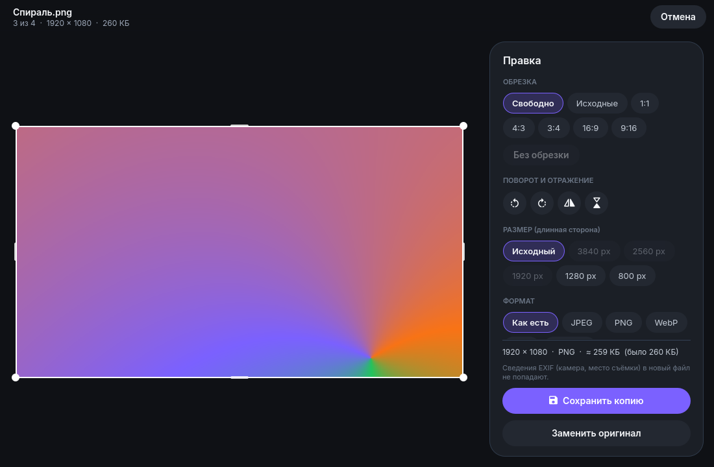
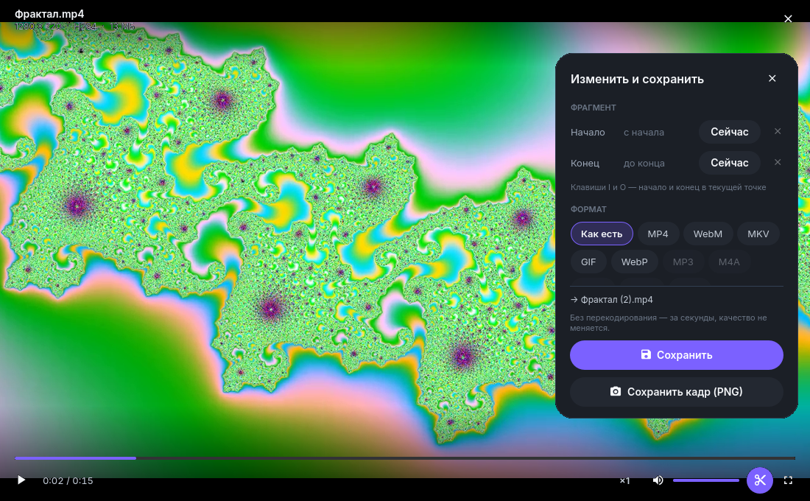
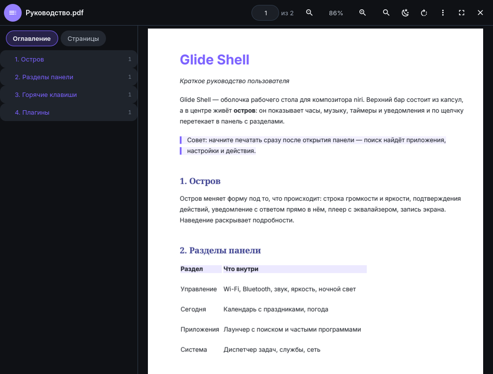
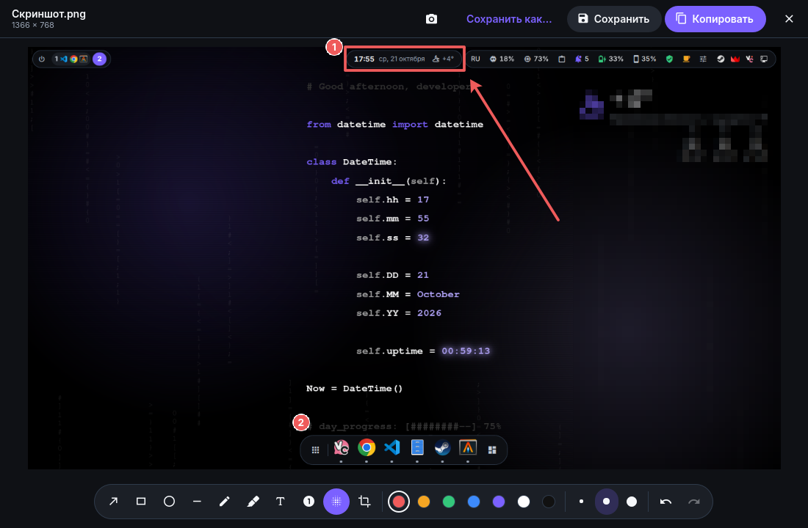
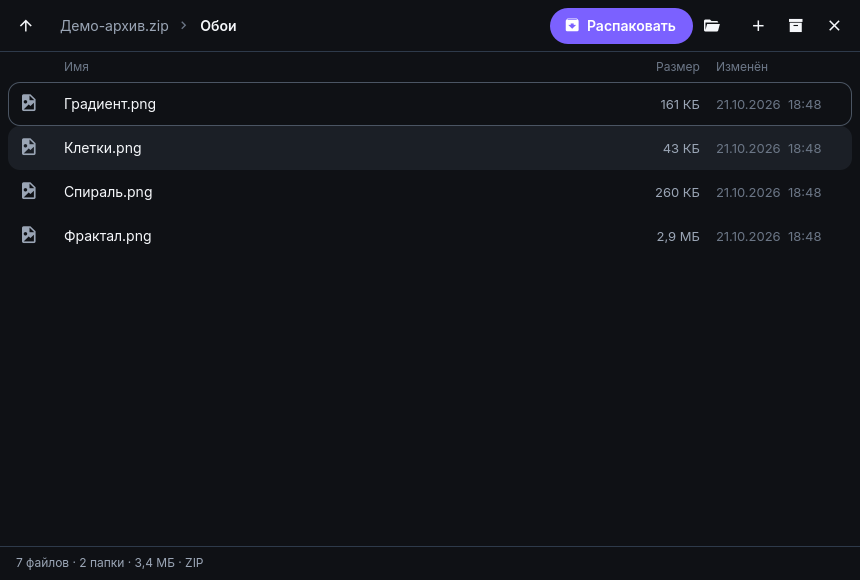

# Glide Apps

[English](README.md) · **Русский**

Дополнение к [Glide Shell](https://github.com/fdhy23qd/Glide-shell): лёгкие повседневные приложения в том же стиле.



| | |
|---|---|
|  |  |
| Видео: плеер и редактор | PDF |
|  |  |
| Скриншоты: разметка | Архивы |

Лёгкие базовые приложения экосистемы Glide на C++ и QML (системный Qt 6 — тот же, что у Glide Shell).
Тема и язык — из настроек Glide Shell (`~/.config/glide-shell/config.json`: тон, акцент, скругления, размер
текста, светлая/тёмная тема, язык интерфейса — русский или английский), меняются на лету. Плеер всегда тёмный.
Перевод — `common/i18n/en.json` (ключ — русская строка; в QML — `Tr.t("…")`, в C++ — `glideTr("…")`).

| Приложение | Команда | Статус |
|---|---|---|
| Фото — просмотр изображений, сетка папки (G), слайд-шоу (S) | `glide-photos` | готово |
| Видео — плеер и простой редактор (FFmpeg): продолжение с места, субтитры из файлов .srt/.vtt рядом, следующий файл папки | `glide-video` | готово |
| Правка фото — в «Фото» (клавиша E) | `glide-photos` | готово |
| Документы PDF | `glide-pdf` | готово |
| Скриншоты — снимок и разметка | `glide-shot` | готово |
| Архивы — открыть, распаковать, создать | `glide-archive` | готово |

## Установка

```sh
git clone https://github.com/fdhy23qd/Glide-apps && cd Glide-apps
sh install.sh        # сборка (cmake + ninja) и установка в ~/.local: bin, applications, icons
```

Нужны (названия пакетов Arch): `qt6-base`, `qt6-declarative`, `qt6-multimedia`, `qt6-shadertools`, `qt6-webengine`
(в нём Qt PDF), `libarchive`, `ffmpeg`, для сборки — `cmake`, `ninja`. По желанию: `kimageformats` (AVIF, HEIC,
JPEG XL), `intel-media-driver` (аппаратное декодирование видео), `7zip` (зашифрованные 7z и RAR).
Без Glide Shell приложения работают с темой Glide по умолчанию.

Ассоциации файлов установка не меняет. Сделать Фото и Видео приложениями по умолчанию:

```sh
xdg-mime default glide-photos.desktop image/jpeg image/png image/webp image/gif image/svg+xml image/bmp image/tiff
xdg-mime default glide-video.desktop video/mp4 video/x-matroska video/webm video/quicktime video/x-msvideo
```

## Фото

Открывается за ~0,3 с, ~30–45 МБ своей памяти (остальное — общие с Glide Shell библиотеки Qt).
Картинка грузится уменьшенной до размера экрана; полный размер — только когда приблизили сильнее.
Соседние фото подгружаются заранее — листание без задержки.

| Действие | Как |
|---|---|
| Следующее / предыдущее | → ← · PgDn PgUp · Пробел, Backspace · свайп двумя пальцами вбок |
| Первое / последнее | Home / End |
| Масштаб | колесо (под курсором) · щипок · + − · 0 — по размеру окна · 1 — 100 % |
| По размеру ↔ 100 % | двойной щелчок или щелчок по проценту в шапке |
| Двигать приближенное | перетаскивание · прокрутка тачпадом |
| Повернуть (только в просмотре) | R / Shift+R |
| В корзину / вернуть | Delete / Ctrl+Z (или «Отменить» во всплывающей строке) |
| Копировать изображение / путь | Ctrl+C / Ctrl+Shift+C |
| Открыть файл | Ctrl+O (системное окно через xdg-desktop-portal) или перетащить в окно |
| Сведения | I |
| Правка | E (Esc — отмена, Ctrl+S — сохранить копию) |
| Во весь экран | F, F11, двойной щелчок по шапке |
| Закрыть | Esc, Ctrl+W |

**Правка** (E или карандаш в шапке): обрезка рамкой (свободно, исходные пропорции, 1:1, 4:3, 3:4, 16:9, 9:16),
поворот и отражение, размер по длинной стороне (3840…800 px), формат (как есть, JPEG, PNG, WebP, AVIF,
JPEG XL — последние два через ffmpeg), качество с оценкой размера файла на лету. «Сохранить копию» (Ctrl+S) —
«имя (изменено).jpg» рядом; «Заменить оригинал» — оригинал уходит в корзину, Ctrl+Z или «Отменить» вернёт его.
EXIF в новый файл не переносится (поворот по EXIF уже применён к пикселям). Анимацию и SVG править нельзя.
Самотест: `cmake --build build --target glide-photos-selftest && QT_QPA_PLATFORM=offscreen build/photos/glide-photos-selftest ПАПКА`.

Форматы — всё, что умеет Qt: JPEG, PNG, WebP, GIF (с анимацией), SVG, TIFF, BMP, TGA, ICO.
AVIF, HEIC и JPEG XL появятся сами после установки пакета `kimageformats`. Поворот по EXIF учитывается.

## Видео

Окно за ~0,4 с, воспроизведение с ~0,5 с. Продолжает с места, где остановились (ролики длиннее 1,5 мин),
не даёт гаснуть экрану, пока идёт видео, и отдаёт MPRIS — работают медиаклавиши (`playerctl`) и остров
Glide Shell. Видео и аудио папки листаются как плейлист.

| Действие | Как |
|---|---|
| Пауза | Пробел, K, щелчок по видео |
| Перемотка | ← → 5 с · J L 10 с · Shift — 1 с · Ctrl — 1 мин · 0…9 — к 0…90 % · полоса |
| По кадру (на паузе) | , . |
| Громкость / без звука | ↑ ↓, колесо над видео / M |
| Скорость | [ ] · Backspace — обычная · меню «×1» |
| Звук и субтитры | кнопка с дорожками (если их несколько) |
| Следующий / предыдущий файл | N P · PgDn PgUp |
| Во весь экран | F, F11, двойной щелчок |
| Изменить и сохранить | E — панель; I / O — начало и конец фрагмента; Ctrl+S — сохранить |
| Кадр в PNG | S |

**Редактор** (панель E) — всё через ffmpeg, смотреть можно дальше:
фрагмент (точно, с перекодированием; или «без перекодирования» — за секунды, но начало по ключевому кадру),
формат (MP4, WebM, MKV, GIF, WebP, MP3, M4A, Opus, FLAC, WAV), качество (высокое/среднее/маленький файл),
размер (1080p…360p по короткой стороне — и для вертикального видео), без звука, поворот.
Файл сохраняется рядом с исходным («имя — фрагмент.mp4», без перезаписи).

Аппаратное декодирование и кодирование — VA-API встроенной графики Intel: появится само после установки
`intel-media-driver` (без драйвера декодирует процессор: 720p30 ≈ 20 % одного ядра). Дискретную NVIDIA
плеер не будит (`QT_FFMPEG_DECODING_HW_DEVICE_TYPES=vaapi`).

Самотест редактора: `cmake --build build --target glide-video-selftest && build/video/glide-video-selftest ПАПКА`
(нужны clip1.mp4, clip2.webm, clip3-vertical.mp4, song.mp3 — см. начало `video/selftest.cpp`).

## PDF

Окно за ~0,3 с (документ открывается сразу после первого кадра), ~55 МБ своей памяти. Страницы лентой,
рисуются только видимые — в разрешении под масштаб. Продолжает с того места, где остановились.

| Действие | Как |
|---|---|
| Листать | колесо, тачпад, PgDn/PgUp, Пробел, ↑↓; ←→ — по странице; Home/End |
| Перейти на страницу | поле номера в шапке, G или Ctrl+G |
| Масштаб | Ctrl+колесо, щипок, Ctrl+± · Ctrl+0 — по ширине · Ctrl+1 — 100 % · Ctrl+2 — страница целиком |
| Поиск | Ctrl+F или / · Enter / Shift+Enter, F3 / Shift+F3 — следующее/предыдущее |
| Оглавление и миниатюры | F9 или Ctrl+B |
| Выделить и копировать текст | мышью · Ctrl+A — вся страница · Ctrl+C |
| Ссылки | внутренние — переход (Alt+← или Backspace — назад), внешние — только http(s) и почта |
| Ночной режим / поворот | D / R |
| Сведения о документе | меню «Ещё» |

Документы с паролем открываются после ввода пароля. Печати нет (Qt PDF её не умеет).

## Скриншоты

`glide-shot --capture region|window|screen` — снять (родным интерфейсом niri: выделение области, выбор окна)
и сразу открыть в редакторе; `glide-shot файл.png` — разметить готовую картинку. В лаунчере — действия
«Снять область/окно/весь экран». Снимок ложится туда же, куда niri кладёт скриншоты (`screenshot-path`).

Инструменты: стрелка A, рамка R, овал O, линия L, карандаш P, маркер M, текст T, номер шага N, размыть B
(пикселями — номера, почты, пароли), обрезать C. Shift — линии по 45°, рамки квадратные. Цвет — точками,
толщина — 1 2 3. Ctrl+Z / Ctrl+Shift+Z. Ctrl+C — копировать (через wl-copy: остаётся в буфере и после
закрытия), Ctrl+S — сохранить (свежий снимок — поверх него, чужую картинку — рядом «(правка)»),
Ctrl+Shift+S — сохранить как. Файл рисует QPainter по тем же фигурам, что на экране.
Самотест: `cmake --build build --target glide-shot-selftest && QT_QPA_PLATFORM=offscreen build/shot/glide-shot-selftest ПАПКА`.

## Архивы

`glide-archive архив` — содержимое по папкам (размеры, число вложенных, даты); `glide-archive --extract-here
архив…` — распаковать рядом без окна (появится, только если распаковка дольше секунды или нужен пароль);
`glide-archive --create файлы…` — сразу окно «Новый архив». Перетаскивание: архив — открыть, файлы и папки — упаковать.

- Читает libarchive: zip, 7z, rar/rar5, tar с gz/xz/zst/bz2/lz4, iso, cab, cpio, deb, jar, cbz/cbr; одиночный
  сжатый файл (`файл.txt.gz`) — как архив из одного файла. Старые zip из Windows с русскими именами (CP866)
  узнаются сами.
- Распаковка: всё или выбранное (выбранное — без пути до него). «Распаковать» — рядом с архивом: в папку по имени
  архива, а если внутри одна запись — прямо рядом. «В папку…» — через портал. Существующие файлы не затираются —
  рядом ложится «имя (2)». Пути с `..`, абсолютные и через ссылки наружу не распаковываются (счёт — в уведомлении).
- Двойной щелчок по файлу — открыть его программой по умолчанию (копия в `~/.cache/Glide/glide-archive/opened`,
  чистится через сутки).
- Создание: zip (по желанию пароль AES-256), 7z (LZMA2), tar.zst, tar.xz, tar.gz. Пишется в `имя.part`, готовый
  переименовывается — недописанный архив не остаётся. Готовый открывается в окне.
- Зашифрованные 7z и RAR libarchive не расшифровывает — их читает 7-Zip (`7z`, если установлен). Пароль
  передаётся ему через stdin, не в командной строке.
- Клавиши: Enter — открыть, Backspace / Alt+↑ — наверх, Ctrl+A, Ctrl+E — распаковать, Ctrl+Shift+E — в папку,
  Ctrl+N — новый архив, Ctrl+O, Esc — отмена / снять выделение / наверх.

Самотест движка (создать → прочитать → распаковать всё и выбранное → сравнить побайтно по каждому формату;
пароль; архивы из 7z, zip, tar; зашифрованный 7z; «злые» пути; CP866):
`cmake --build build --target glide-archive-selftest && build/archive/glide-archive-selftest ПАПКА`.

Сделать «Архивы» программой по умолчанию явно (или вернуть Nautilus — `org.gnome.Nautilus.desktop`):

```sh
xdg-mime default glide-archive.desktop application/zip application/x-7z-compressed application/vnd.rar \
    application/x-compressed-tar application/x-xz-compressed-tar application/x-zstd-compressed-tar application/x-tar
```

## Разработка

- `common/` — модуль `Glide.Ui`: `Theme` (токены как в Theme.qml Glide Shell), `GlideSettings` (настройки
  оболочки), `IconButton`, `TextButton`, `Chip`, `Toggle`, `Slider`, `TextField`, `PopupMenu`, `Toast`, `ResizeEdges`, `FilePicker` (портал).
- Окна без рамки: niri разрешает клиентские рамки, и Qt нарисовал бы свою. Края тянут размер через композитор.
- Проверка интерфейса без мыши (`common/testhook.h`):

  ```sh
  QT_QPA_PLATFORM=offscreen QT_QUICK_BACKEND=software \
  GLIDE_TEST="500 move:400,300; 800 key:Right; 1200 wheel:400,300,120; 1500 shot:/tmp/a.png; 1600 quit" \
  build/photos/glide-photos фото.jpg
  ```

  Команды: `key:Ctrl+C`, `move:x,y`, `click:x,y`, `dclick:x,y`, `press/drag/release:x,y`, `wheel:x,y,дельта`, `tpad:x,y,dx,dy`, `shot:файл`, `quit`.
- Сообщения Qt без терминала уходят в journald — для отладки `QT_FORCE_STDERR_LOGGING=1`.
- Имена свойств QML: не `z`, `rotation`, `height`, `data` и прочие свойства Item — затирают их (`Cannot override FINAL`).
- В `onXxxChanged` привязки, зависящие от того же свойства, могут быть ещё старыми — считать напрямую.
- `QCoreApplication::quit()` в Qt 6 закрывает окна: `onClosing` с отказом (идёт экспорт) его останавливает.
- В `.desktop` — полный путь в `Exec` (подставляет CMake): GIO/Nautilus прячет приложение из «Открыть с помощью»
  и не даёт назначить по умолчанию, если программы нет в PATH сессии (а `~/.local/bin` там нет). Проверять
  с PATH Nautilus: `env PATH=… gio mime video/mp4`.
- Inline-компоненты (`component X:`) не видят id своего файла — передавать свойствами.
- `ShaderEffect` в `QT_QPA_PLATFORM=offscreen` не рисуется — ночной режим PDF проверять в настоящем окне.
  `layer.effect` на `PdfPageImage` давал пустую страницу — эффект через `ShaderEffectSource`.
- `PdfSearchModel.count` из QML не виден (ревизия 6.8) — считать `rowCount()` по сигналам модели.
- Сигнал с именем `escape` нельзя (глобальная функция JS) — `cancelled`.
- Свойства с именами `left`, `top`, `palette` у Item/Window уже есть — не объявлять свои.
- После ввода в TextInput убирать фокус (`forceActiveFocus` на другом элементе): иначе клавиши-инструменты
  уходят в невидимое поле.
- Скриншоты niri в тестах кладут картинку в историю буфера Glide (лимит 20) — сохранять и возвращать её.
- `WheelHandler` — одна ось (по умолчанию вертикальная): для тачпада вбок — `MouseArea.onWheel`.
- Свой заголовок не называть как системный: `archive/archive.h` перекрывал `<archive.h>` libarchive (каталог
  исходников модуля QML в путях включения) — поэтому `archiver.h`.
- `ListView` сам ставит `x` делегата — отступ строк делать внутренним элементом.
- Ответ из рабочего потока сначала снимает «занят» (`Archive::done`), потом шлёт сигнал — иначе обработчик
  не может сразу начать следующее действие.

## Лицензия
[GPL-3.0-or-later](LICENSE), как и у Glide Shell.
